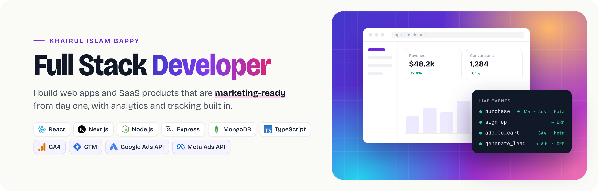

  

  
  
  

## 👋 About me

I'm a **Full Stack Developer** building web applications and SaaS products with **Next.js, React, Node.js, TypeScript and MongoDB**. I also bring **5+ years of experience in conversion tracking and analytics infrastructure** for e-commerce and B2B businesses, so the apps I build ship with analytics, server-side tracking and ad platform integrations designed in from the start.

- 🔨 Building SaaS products and web apps with **Next.js 16, React 19 and MongoDB**
- 🔐 Authentication, protected routes, REST APIs, dashboards and real-time features
- 📊 Analytics & tracking: GA4, Google Tag Manager, server-side tracking, Meta and Google Ads APIs
- 📍 Khulna, Bangladesh · open to **Full Stack Developer** roles

---

## 🚀 Featured projects

### Tagify · server-side tracking SaaS dashboard
Marketing site and customer dashboard for a server-side tracking platform. Every new account gets a seeded demo workspace with a tracking gateway, 30 days of analytics, hosted containers and a live event stream.

- **Authentication** with Better Auth: email/password, Google and GitHub OAuth, password reset
- **Analytics dashboard** powered by MongoDB aggregation pipelines and Recharts
- **Live events page** using Server-Sent Events
- **Protected routes**, server-side session checks on every API route, and an admin role
- Request validation with Zod, data fetching with TanStack Query

`Next.js 16` `React 19` `TypeScript` `MongoDB` `Better Auth` `TanStack Query` `Tailwind CSS` `Radix UI` `Zod`
 🌐 [Live demo](https://tagify-brown.vercel.app) · 💻 [Code](https://github.com/bappycode/Tagify-Public)

### Tagify Analytics · Google Ads & GA4 data for AI assistants *(private · in development)*
Multi-tenant SaaS that connects a business's Google Ads and GA4 accounts and exposes the data through an **MCP server**, so any AI assistant that supports MCP can query live marketing data in plain language.

- **Google Ads and GA4 connections** per workspace, with encrypted per-tenant credentials and an OAuth connection flow in progress
- **Dynamic MCP endpoints**: each workspace gets its own endpoint that works in any MCP client
- MCP tools for listing accounts and GA4 properties, campaign performance, GA4 summaries, custom GA4 reports and raw **GAQL** queries
- Lets marketers ask questions like "which campaigns lost conversions this week?" and get answers from real account data

`Node.js` `TypeScript` `Google Ads API` `GA4 Data API` `MCP` `OAuth` `Multi-tenant SaaS`

### BazarDor · market price tracker for Bangladesh
Web app for browsing and comparing everyday product prices across markets in Bangladesh.

- Product browsing by category, search and sorting
- Price comparison across markets with lowest-price highlighting
- Daily price increase and decrease highlights
- User sign-up, sign-in and profile with Better Auth and MongoDB
- Loading states, custom 404 and fully responsive layout

`Next.js 16` `React 19` `TypeScript` `MongoDB` `Better Auth` `Tailwind CSS` `REST API`
 🌐 [Live demo](https://bazar-dor-mu.vercel.app) · 💻 [Code](https://github.com/bappycode/bazar-dor)

### FitLog · workout library and daily planner
Gym companion app for browsing workouts, planning the day and tracking totals.

- Workout library from an API with skeleton loading and dynamic detail pages
- Today's plan and saved list with the Context API, capped at five workouts
- Dashboard with live exercise, minute and calorie totals, sorting and tabs
- State persisted in localStorage, custom 404 and error pages

`Next.js 16` `React 19` `Context API` `Tailwind CSS` `localStorage`
 🌐 [Live demo](https://fit-log-me.vercel.app) · 💻 [Code](https://github.com/bappycode/fit-log.me)

### DevStack · tech stack builder
Single-page React app for browsing popular web technologies and building your own stack.

- Technology cards with icon, category, difficulty level and star rating
- Add to and remove from a "Your Stack" panel, or clear it in one click
- Data loaded with React 19's `use()` hook and `Suspense`
- Toast feedback on every action and a responsive layout

`React 19` `TypeScript` `Vite` `Tailwind CSS` `DaisyUI` `React Toastify`
 🌐 [Live demo](https://devstack-chi.vercel.app) · 💻 [Code](https://github.com/bappycode/DevStack.me)
---

## 🛠 Tech stack

**Frontend**

  
  
  
  
  
  

**Backend & database**

  
  
  
  
  
  
  

**Deployment & tools**

  
  
  
  
  

**Analytics & tracking**

  
  
  
  

---

## 📊 GitHub activity

  

